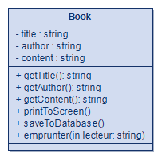
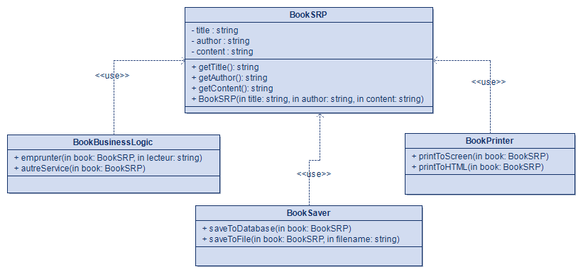
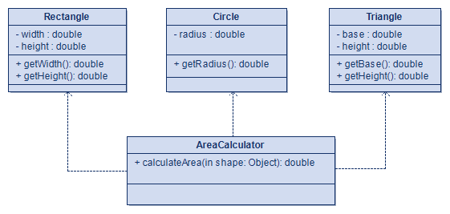
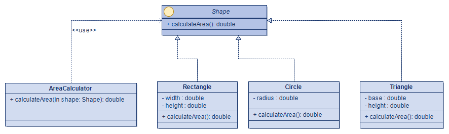
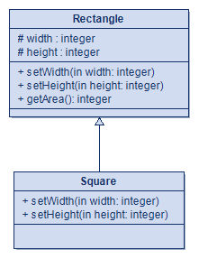
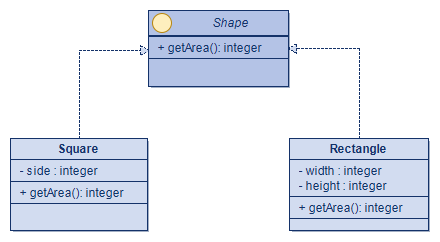
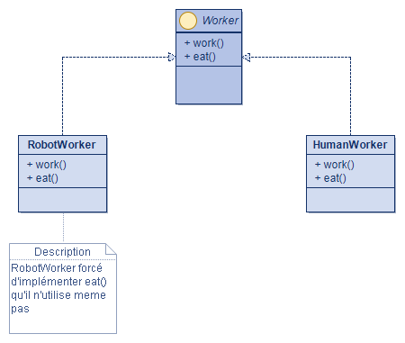
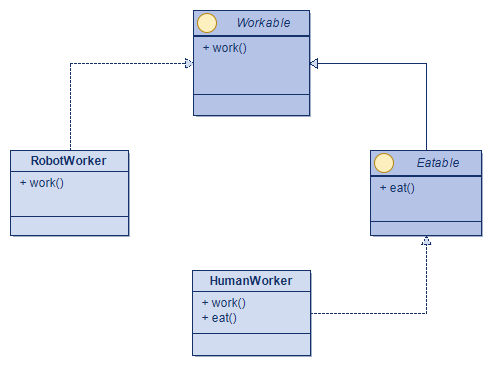
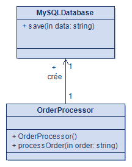
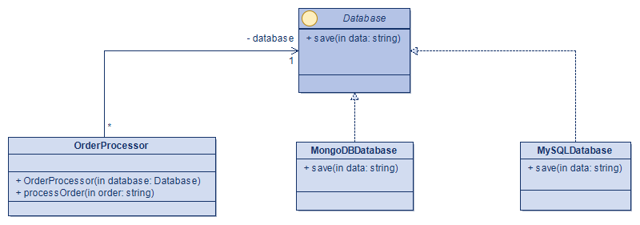

# Principes SOLID en Java : code avant / après

Projet du cours **INF4067 : UML et Design Patterns**

Pour chacun des cinq principes SOLID, le dépôt contient :

- une version du code qui **viole** le principe (`before`) ;
- une version **refactorée** qui le respecte (`after`) ;
- le **modèle UML** (diagramme de classes réalisé avec Modelio) de chaque version ;
- des **tests** qui prouvent la violation avant et le bon comportement après.

## Structure du dépôt

```
solid-principles-inf4067/
├── README.md
├── run.sh                      # compile et lance les tests (Linux / macOS)
├── run.bat                     # idem pour Windows
├── docs/
│   └── diagrammes/             # modèles UML (PNG) : <principe>_avant.png / <principe>_apres.png
└── src/
    ├── main/java/inf4067/solid/
    │   ├── srp/{before,after}/
    │   ├── ocp/{before,after}/
    │   ├── lsp/{before,after}/
    │   ├── isp/{before,after}/
    │   └── dip/{before,after}/
    └── test/java/inf4067/solid/test/
        ├── Check.java          # mini framework de test (sans dépendance)
        ├── SrpTest.java  OcpTest.java  LspTest.java  IspTest.java  DipTest.java
        └── AllTests.java       # point d'entrée
```

## Prérequis

JDK 11 ou plus récent (testé avec JDK 25)

## Exécuter les tests

Linux / macOS :

```sh
./run.sh
```

Windows :

```bat
run.bat
```

Résultat attendu : `Résultat : 33 réussis, 0 échoués`.

Les tests de la version `before` montrent la violation (par exemple `Triangle` rejeté par l'ancien `AreaCalculator`, ou l'aire de 16 au lieu de 20 pour `Square`). Ceux de la version `after` montrent le comportement correct.

## Modèles UML

Modèles réalisés avec [Modelio](https://www.modelio.org/).

### SRP

| Avant | Après |
|---|---|
|  |  |

### OCP

| Avant | Après |
|---|---|
|  |  |

### LSP

| Avant | Après |
|---|---|
|  |  |

### ISP

| Avant | Après |
|---|---|
|  |  |

### DIP

| Avant | Après |
|---|---|
|  |  |

## Auteur

KOTSADI DOUMASSOU ALLANE DJAMEL 22U2025
Enseignant : Valéry MONTHE.
